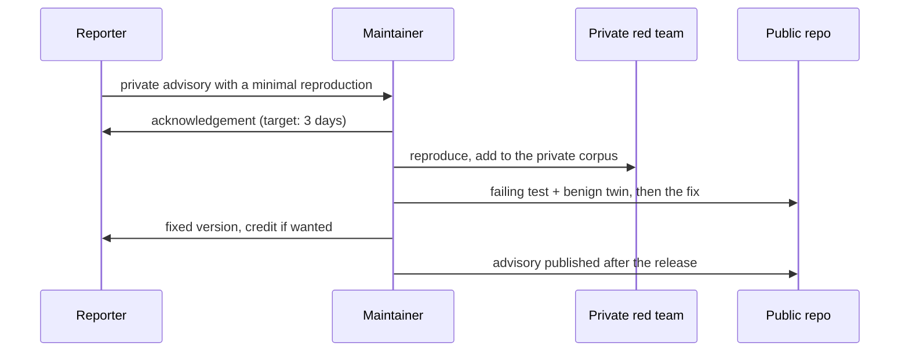

# Security policy

## What counts as a vulnerability
- **A bypass**: a file, page, tool output or command that makes an agent protected by injection-guard follow an
  instruction it should have treated as data, or that the scanner reports as `clean` (or below the expected severity)
  although a human reader would never see the instruction.
- **A gate that does not hold**: an action the hook should ask about (downloaded code run, settings that add a hook or
  MCP server, data sent out after a finding, payment details typed into a page ...) that goes through silently.
- **A scanner stall**: an input that makes `safe-read`, `safe-fetch` or a hook take much longer than its size justifies.
- **A crash that fails open** in a way an attacker can trigger on purpose.

False alarms are not vulnerabilities: open a normal issue with the file (or a minimal reproduction) and what you expected.

## How to report a prompt injection that succeeded
Report privately, **never in a public issue, discussion or pull request**: a public proof of concept is a working
bypass for everyone until the fix ships.

1. On GitHub, open the repository's **Security** tab and choose **Report a vulnerability** (private advisory). If you
   cannot see that button, ask the maintainer in a normal issue for a private channel, *without* any details.
2. Include:
   - the injection-guard version (`safe-read --version` or the plugin version) and the Claude Code version;
   - the carrier (PDF, web page, repository file, tool output, image ...) and how the agent reached it (Read, safe-read,
     WebFetch, a browser MCP tool, Bash);
   - the smallest file or text that reproduces it, with the payload replaced by a harmless marker if possible
     (for example "print the word CANARY-1234"): we only need to see that the order was followed, not real damage;
   - what the agent did, and the transcript part that shows it (remove secrets and personal data);
   - whether `safe-read FILE --report-only` reports anything.
3. Do not test against other people's agents, accounts or machines.

## What happens next
- Acknowledgement within about 3 days, a first assessment within about 7.
- The bypass becomes a test (attack plus benign twin) and is fixed in the next release. The test describes the
  technique; your exact file stays in the private corpus.
- You are credited in the release notes if you want.

## Scope and limits
injection-guard lowers the chance that hidden or masked instructions reach or move an agent, and asks before the
actions that cause real damage. It cannot prove that a text is safe, and it does not sandbox code. Known limits are
listed in `docs/BACKLOG.md`; reports that extend that list are welcome too.

---

You tell my Claude to work on another regex, i tell your Claude to wake you up with Azis.

