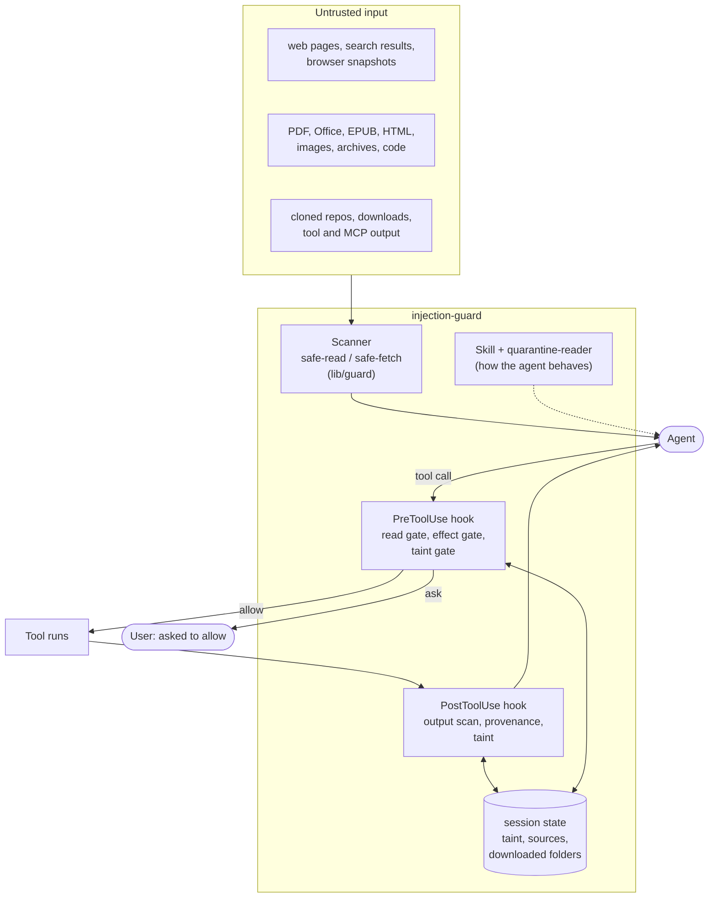
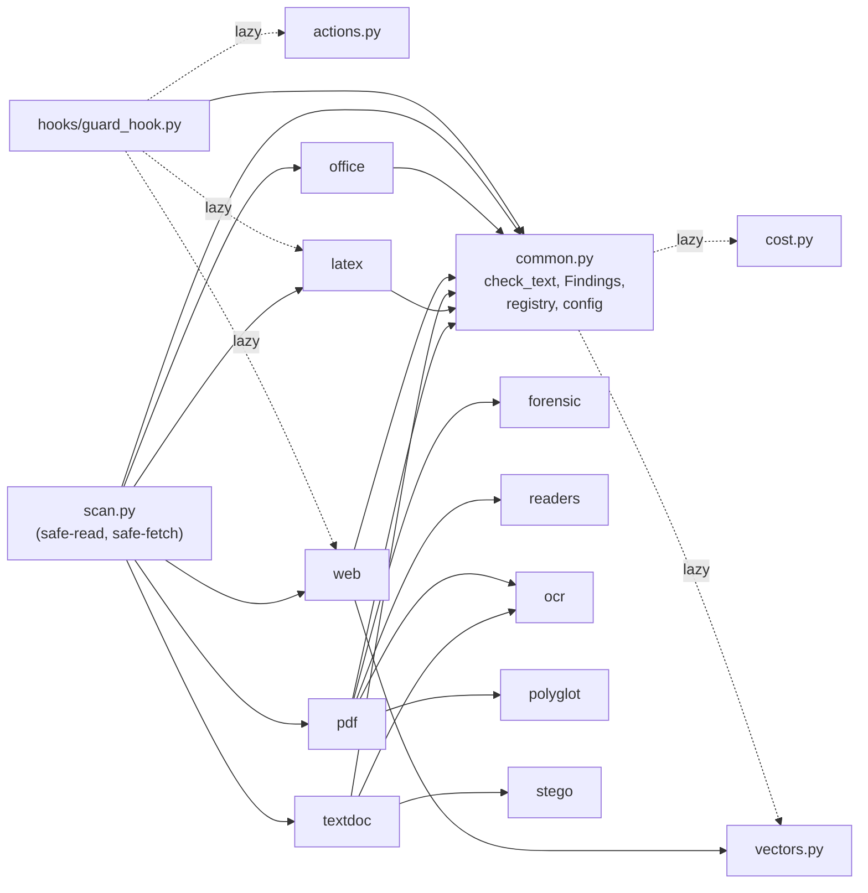
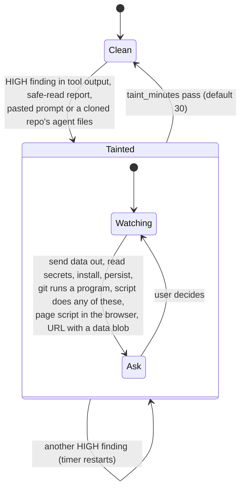
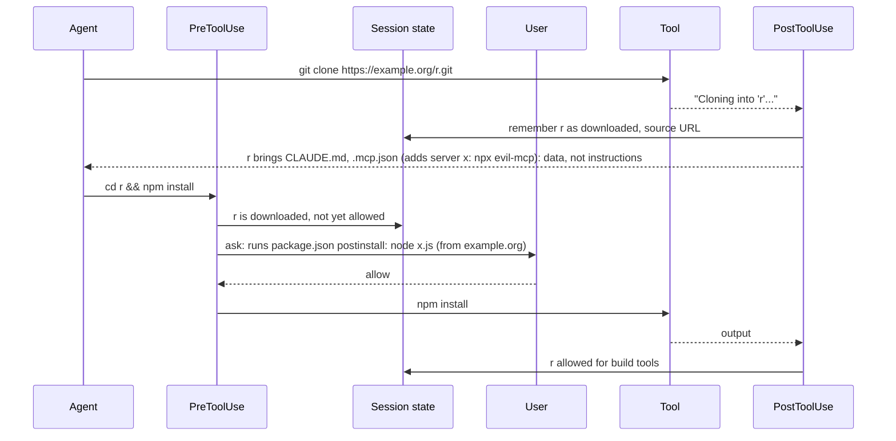

# Architecture

## The layers at a glance



Three ideas carry the design:
1. **What a human sees is the content.** Everything else (hidden CSS, white text, metadata, comments, encodings) is
   reported and removed before the agent reads it.
2. **Wording is a signal, effect is the gate.** Patterns catch known and respelled wording; the hook does not rely on
   them. Actions that cause damage (data out, secrets read, code from a download run, settings that run programs,
   payment details typed) are shown to the user with their effect and source before they happen.
3. **Findings change what the agent may do next.** A HIGH finding taints the session; while tainted, risky actions ask.

## Flow of one scan
```
safe-read FILE ──► scan.main_read ──► scan.scan_file(path, F)
                                        │  detect(): magic bytes, not the extension
                                        ├─ pdf      ─► pdf.scan_pdf            (structure, metadata, text layer, render diff,
                                        │                                      images, ambiguity, readers, forensic.*, OCR)
                                        ├─ zipdoc   ─► office.scan_zip_doc     (DOCX/PPTX/XLSX/ODF/EPUB, else scan_archive)
                                        ├─ compressed ► scan.scan_compressed   (tar, tar.gz/bz2/xz, gz/bz2/xz)
                                        ├─ image    ─► textdoc.scan_image ─► stego.deep_image, ocr.ocr_picture
                                        ├─ html     ─► web.sanitize_html       (hidden CSS/attrs, comments, data: URIs, JS, direction)
                                        ├─ text     ─► latex.scan_latex | textdoc.scan_text
                                        └─ other    ─► scan.scan_binary        (strings, macOS metadata)
                                        then polyglot.polyglot() for every non-text file
                                      ► registry_put(sha256 -> verdict)   ~/.cache/injection-guard/scanned/
                                      ► emit(): report, RULES line, visible text between <<<UNTRUSTED CONTENT nonce>>> markers
```
`safe-fetch URL` downloads with a browser user agent into `~/.cache/injection-guard/fetch/`, runs the same
`scan_file`, then `cloak_check` re-fetches as AI user agents and compares the visible words.

## Modules (`plugins/injection-guard/lib/guard/`)
| Module | Owns |
|---|---|
| `common.py` | pattern families (`STRONG`, `KEYWORDS`, `DIRECTIVE`, `IMPERSONATION`, `TASK_VOCAB`/`TASK_MODIFIER`, Unicode sets, look-alikes), `check_text()` (the text-level detector every format calls), `decoded_variants()` (ciphers/encodings), `whitespace_stego()`, `Findings`, config, registry |
| `pdf.py` | raw structure (streams, strings, names, comments, CMaps, XMP, JS), metadata/attachments, text layer + crop diff, render diff + visible-text extraction, embedded images, ActualText / remap judgement |
| `forensic.py` | glyph audit (MuPDF trace), per-glyph cover check, provenance, reference diff, glyph OCR of embedded fonts, tagged reading order |
| `readers.py` | poppler vs MuPDF vs pypdf text comparison |
| `ocr.py` | tesseract wrappers, page OCR vs text layer, faint-text OCR, picture OCR |
| `polyglot.py` | polyglot signatures, revisions, duplicate objects, trailers, PDF JavaScript runtime calls |
| `web.py` | HTML/SVG sanitiser, CSS hiding rules, data: URIs, scripts, direction tricks, deceptive links, `check_output()` (structural pass for markup that arrives as tool output) |
| `cost.py` | token-cost instructions (`cost_signals()`), `squeeze()` (repeated lines, padding and encoded blobs collapsed in the printed text) |
| `vectors.py` | browsing and shopping signals: ClickFix, clipboard writes, image-URL exfiltration, spreadsheet formulas, disguised extensions, text addressed to AI readers, steering and concealment (`signals()`, `steering()`, `clipboard_check()`) |
| `actions.py` | pure helpers for the effect gate: downloaded folders, build/test tools and what they run, `.git/config` that runs programs, agent config effects (hooks, MCP servers, permissions), typo-squatted packages, payment details, shell syntax in file names |
| `office.py` | DOCX/PPTX/XLSX/ODF/EPUB parsers, generic zip archives |
| `latex.py` | LaTeX/BibTeX hidden spans and compile-time code |
| `textdoc.py` | Markdown/plain text, images (metadata, faint content) |
| `stego.py` | PNG chunks, JPEG segments, alpha tricks, LSB, scaling attacks |
| `scan.py` | type detection, dispatch, archives, binaries, CLI (`safe-read`, `safe-fetch`), output envelope |
| `hooks/guard_hook.py` | `pre` (read gate, WebFetch route, shell readers, self-protection, effect gate, taint gate), `post` (output scan, provenance, LaTeX read check), `session`, `prompt` |



## Findings API
```python
F = Findings()
F.add(sev, kind, where, detail)   # sev: "HIGH" | "MED" | "INFO"; duplicates (same 4-tuple) are dropped
F.verdict()                       # "HIGH" if any HIGH, else "MED" if any MED, else "clean"
```
Tests assert on `kind` substrings (`has_kind(F, "covered glyphs", "HIGH")`). **Renaming a `kind` breaks tests and the
docs mapping** - keep the wording, or update both deliberately.

## Severity rules
- **HIGH**: hidden or encoded text aimed at an AI, impersonation, a hidden directive or task modifier, a structural
  trick that only makes sense for hiding (invisible render mode with text, ToUnicode remap confirmed by spelling,
  appended stream with invisible text, earlier revision with AI text ...).
- **MED**: something a reader could see differently from a human without proof of intent (hidden text without AI
  words, off-page text, faint ink, polyglot signs, live scripts, failed scan steps). Raw reads stay blocked (`block_on: MED`).
- **INFO**: normal but worth knowing (accessibility ActualText that matches the glyphs, LaTeX author comments,
  math-font duplicate glyphs, light-grey design text).
- `check_text(text, where, F, hidden=...)`: `hidden=True` means a human never sees this text - keywords, directives and
  task vocabulary become HIGH. Visible directives are INFO (students see them too).

## Hooks and the registry
The pre-hook denies raw reads of documents whose SHA-256 has no registry entry, and of entries with verdict HIGH/MED
(strict mode). Trust is bound to the exact bytes: any change re-opens the gate. Guard files, cache and the plugin's
settings entry are protected with `ask`. Config: `~/.config/injection-guard/config.json` (`mode`, `block_on`,
`trusted_paths`, `html_in_git_is_source`), environment override `INJECTION_GUARD_MODE`.

**Session taint.** When a HIGH finding reaches the context (tool output, a flagged safe-read report, hidden text in a
pasted prompt), the session is marked for `taint_minutes`. While marked, the pre-hook asks before commands that an
injected instruction would want: sending data out, reading credentials, installing packages, changing what runs
later, git options that run a program, and local scripts whose content does any of these (the script is read when it
is run, so writing it in harmless steps does not help). Detection can miss wording; this gate does not depend on it.



## Effect gate (round 7)
Masked injections read like normal setup guides ("add this MCP server", "run make to finish"), so wording cannot
separate them. The effect gate asks **always** (not only when tainted) before actions whose effect outlives the command
or runs someone else's code, and the question shows the effect plus where outside content came from in this session:

| Action | What the ask shows |
|---|---|
| Write/Edit of `.mcp.json`, `.claude/settings*.json`, `~/.claude.json`, `.vscode/tasks.json`, `devcontainer.json` | each new hook command, MCP server (command, args, URL), permission allow rule, env variable, auto-run task; unchanged effects pass |
| `claude mcp add`, `claude plugin install`, `claude plugin marketplace add` | the exact server or plugin |
| pytest, make, npm/yarn/pnpm, pip install ., cargo, go generate, direnv, tox ... inside a folder downloaded this session | what would run: conftest.py count, Makefile recipes, package.json install scripts, build.rs, .envrc; asked once per folder (a run that went through counts as allowed) |
| any git command in a repository whose `.git/config` makes git run a program (fsmonitor, sshCommand, pager with shell syntax, `!` aliases) | the line and file |
| pip/npm/npx package one typo away from a popular one | the popular name and where to check the publisher |
| browser type/fill tools with a checksum-valid card number or IBAN | a reminder to check the domain and amount |


