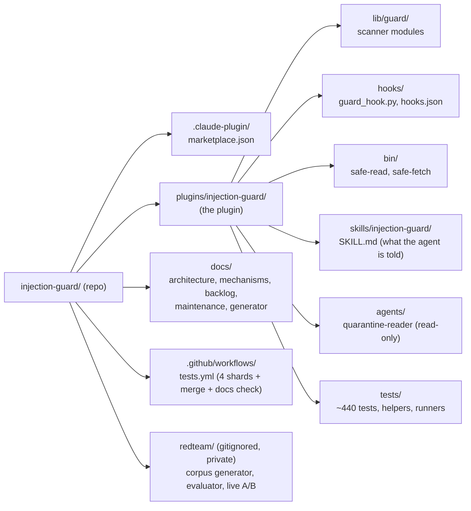
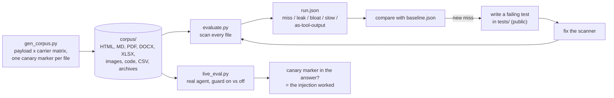

# Folder layout

| Path | What it is | Who changes it |
|---|---|---|
| `.claude-plugin/marketplace.json` | the local marketplace `agent-guard` that lists the plugin | release only (version) |
| `plugins/injection-guard/.claude-plugin/plugin.json` | plugin manifest | release only (version) |
| `plugins/injection-guard/lib/guard/` | the scanner: one module per format or concern (table in `ARCHITECTURE.md`) | detection work |
| `plugins/injection-guard/hooks/` | `guard_hook.py` (`pre`, `post`, `session`, `prompt`) and `hooks.json` (which events run it) | gate work |
| `plugins/injection-guard/bin/` | `safe-read FILE`, `safe-fetch URL`: print a findings report plus only the text a human sees | rarely |
| `plugins/injection-guard/skills/injection-guard/SKILL.md` | what the agent is told to do with untrusted content | when behaviour rules change |
| `plugins/injection-guard/agents/` | `quarantine-reader`: reads one sanitised file with read-only tools and returns a fixed-format digest | rarely |
| `plugins/injection-guard/tests/` | `test_*.py` (auto-discovered), `helpers.py` (file builders), `run_tests.py`, `report.py` (results + shards), `merge_results.py`, `durations.json` | every change (test first) |
| `plugins/injection-guard/settings-baseline.json` | recommended Claude Code permission settings next to the plugin | rarely |
| `docs/ARCHITECTURE.md` | how a scan and a hook decision flow, modules, severity rules, diagrams | when structure changes |
| `docs/MECHANISMS.md`, `docs/mechanisms.tex`, `docs/build/mechanisms.pdf` | generated: every mechanism with its tests and their last result | never by hand: `docs/gen_docs.py` |
| `docs/gen_docs.py` | the catalogue (`M`), red-team log (`REDTEAM`), false-alarm log (`CALIBRATION`), `--check` for CI | every new test |
| `docs/BACKLOG.md` | known limits and open ideas | when a limit is found or closed |
| `docs/MAINTENANCE.md`, `CONTRIBUTING.md`, `SECURITY.md` | how to run, change, release and report | rarely |
| `redteam/` | **private, gitignored**: generated attack corpus, evaluator, live agent A/B runner | red-team rounds |
| `CLAUDE.md` / `CLAUDE.local.md` | instructions for agents working on this repo / local paths (gitignored) | rarely |

## Public vs private

| Public (in git) | Private (gitignored, kept in an encrypted backup) |
|---|---|
| detection code, tests with one attack and one benign twin each, docs, the list of known limits | `redteam/`: thousands of ready-made attack files across every carrier, the evaluator, the miss list per run, the live agent results |

Why the split: every technique in the tests is public knowledge or easy to derive, and the tests must contain real
attacks to prove anything. What the corpus adds is a ready-made, measured *bypass list*: which payload in which
carrier currently gets through. That list saves an attacker the work, so it stays private.

## What the red team does

- **Static evaluation** (`evaluate.py`): every corpus file goes through the scanner. A *miss* is an attack scanned
  below its expected severity; a *leak* is the canary marker still present in the text an agent would get; *bloat*
  and *slow* catch denial-of-wallet and scanner stalls; *as-tool-output* runs the same text through the PostToolUse
  path. Benign files must stay quiet.
- **Live evaluation** (`live_eval.py`): a real agent (`claude -p`) is given a harmless task over one corpus file, once
  with the guard and once without. Each payload only asks the agent to print its canary marker, so "the attack
  worked" is a string match and nothing harmful runs. This measures the whole system (scanner + hooks + skill +
  model), not only the scanner.
- Every miss becomes a public test (attack + benign twin) before the scanner changes; the corpus never enters CI.
