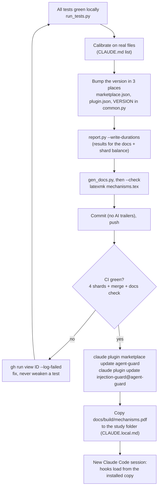

# Maintenance

## Release



Commands, from the repo root:
```bash
python3 -I plugins/injection-guard/tests/report.py --write-durations
python3 -I docs/gen_docs.py && python3 -I docs/gen_docs.py --check
PATH=$HOME/texlive/2026/bin/x86_64-linux:$PATH latexmk -pdf -interaction=nonstopmode -halt-on-error -outdir=docs/build docs/mechanisms.tex
git commit -am "Release X.Y.Z: ..." && git push && gh run watch
claude plugin marketplace update agent-guard && claude plugin update injection-guard@agent-guard
```

## Versions
`MAJOR.MINOR.PATCH`. MINOR for new detections or gates, PATCH for false-alarm fixes and speed. The three version
strings must match; `test_cli_hooks` checks the banner.

## CI
- `.github/workflows/tests.yml`: 4 shards balanced by `tests/durations.json`, then `merge` fails on a failed or missing
  shard, a test that ran twice, or a count that differs from `report.py --count`, then the docs check fails on
  unmapped tests or mapped tests that no longer exist.
- After adding slow tests, refresh `durations.json` (`report.py --write-durations`), or one shard becomes the bottleneck.
- New `test_*.py` modules are discovered automatically; nothing to register.

## Calibration (false alarms)
After any detection change, scan the real files listed in `CLAUDE.md` (`IG_REAL_SHEETS`, `IG_REAL_TEMPLATE`, the
course survey). A new false alarm: reproduce with `safe-read FILE --report-only`, look at the rendered page, narrow the
rule, add the benign case as a test, add a `CALIBRATION` row in `docs/gen_docs.py`.

## Red team (private)
`redteam/` is gitignored. A round: `python3 redteam/gen_corpus.py`, `python3 redteam/evaluate.py --out runN.json`,
compare with `baseline.json`; for each new miss write a public test, fix, re-run; then refresh the baseline. A live
round (`redteam/live_eval.py`) spends model usage: run a small pilot first. Keep a copy of `redteam/` in the encrypted
backup (`~/.local/share/injection-guard-redteam/`), never in git.

## Session state and caches
| Path | What | Safe to delete |
|---|---|---|
| `~/.cache/injection-guard/scanned/` | registry: SHA-256 to verdict | yes (files get re-scanned) |
| `~/.cache/injection-guard/sessions/` | per-session taint, findings already reported, downloaded folders, external sources | yes (state resets) |
| `~/.cache/injection-guard/fetch/` | pages fetched by `safe-fetch` | yes |
| `~/.cache/injection-guard/hook-errors.log` | hook crashes (the hook fails open) | read it first |
| `~/.config/injection-guard/config.json` | `mode`, `block_on`, `trusted_paths`, `taint_minutes` | no (user settings) |

Check `hook-errors.log` after every release: a crash means a gate silently did nothing.

## Performance budget
The hooks run on every tool call. Targets: `pre` < 150 ms, `post` < 300 ms on normal output. Measure with
`time (echo '{"tool_name":"Bash","tool_input":{"command":"ls"}}' | python3 -I plugins/injection-guard/hooks/guard_hook.py pre)`.
Modules are imported lazily (`actions.py`, `vectors.py`, the format parsers), so a hook pays only for what it uses.
